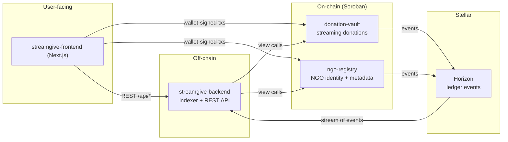

# Architecture

StreamGive is composed of four components that ship independently but
operate as one system. A new contributor reading each component's
README individually has to reconstruct the picture themselves; this
document shows it in one place.

## System overview

## The four components

### `ngo-registry` (Soroban contract)

Owns the canonical list of NGOs. Each `Ngo` record stores only three fields:
the NGO's `owner` address, display `name`, and `verified` flag. When a
registry is configured on `donation-vault` via `set_registry`, the vault
verifies NGOs against `ngo-registry` on `create_stream`, `top_up`, and
`transfer_stream` (failing closed if the lookup fails or the NGO is not
verified); until `set_registry` is called — or after `clear_registry` — no
registry check is performed. Applications (`register`, `update_name`,
`unregister`) are owner-gated; verification and moderation (`approve_ngo`,
`batch_approve`, `reject_ngo`, `revoke_ngo`, `remove_ngo`) are privileged — the
four review entry points accept the admin or any address on the admin-managed
approver list (`add_approver` / `remove_approver`), while `remove_ngo` stays
admin-only, so
review work can be delegated without sharing the admin key; reads and
`touch_ngo` are public.

### `donation-vault` (Soroban contract)

Holds donor funds and streams them to an NGO at a fixed rate per second.
Owns the `Stream` struct and the full lifecycle: `create_stream`,
`withdraw`, `withdraw_batch`, `withdraw_all`, `top_up`, `modify_rate`,
`transfer_stream`, `cancel_stream`, and `rescue_stream`. Emits typed Soroban
events for stream
lifecycle transitions and admin configuration changes, though not every
state-changing call emits exactly one event: TTL-only bumps (`extend_stream`)
and no-op calls (such as `modify_rate` with the same rate, `transfer_stream`
to the same NGO, `clear_token_fee_bps` with no override, or `cancel_stream`
when nothing moved) emit no event, while `withdraw_batch` and `withdraw_all`
emit one `withdraw` event per contributing stream. See `docs/EVENTS.md` for the
topic/data schema.

#### Token transfers and reentrancy

Calls to a token contract are external interaction boundaries. The vault's
security invariant is checks-effects-interactions: finalize and persist the
stream accounting affected by an operation before calling the token contract.
If accounting is written after a transfer, a reentrant call could observe stale
state and act on a balance or accrual that has already been paid. Do not change
transfer ordering without a security review. The vault relies on configured
tokens being trusted, standard contracts that follow the expected token
interface; it is not designed to defend against arbitrary malicious token
implementations.

This ordering is not currently consistent across all paths: `withdraw` stores
its payout accounting before transferring, but `create_stream` and `top_up`
transfer incoming funds before persisting the corresponding stream state, and
`cancel_stream` transfers before persisting its final cancellation state (its
`settle` helper also transfers accrued funds before recording that payout).
`top_up` and `modify_rate` also call `settle`, which can transfer accrued funds
before their updated stream state is persisted. The reentrancy-hardening work
is tracked in [issue #194](https://github.com/StreamGive/streamgive-contracts/issues/194);
until those paths are hardened, do not assume every token transfer follows the
invariant above.

### `streamgive-backend` (Node / TypeScript)

Two jobs, both off-chain:

1. **Indexer** — tails Horizon for `donation-vault` and `ngo-registry`
   events and materialises them into a queryable store.
2. **REST API** — serves the frontend: current streams by NGO, historical
   donation totals, NGO metadata, and health endpoints.

### `streamgive-frontend` (Next.js)

The user-facing app. Connects a Stellar wallet, reads NGO metadata from
the backend, and lets donors open, top up, and cancel streams by signing
Soroban transactions directly against the contracts. It never touches a
private key or the blockchain's raw RPC; signing is delegated to the
wallet extension.

## Supported tokens

`donation-vault` is built for **Stellar Asset Contracts (SACs)**: the token
contract that wraps a classic Stellar asset, including native XLM. Its
accounting assumes one thing about the token: a `transfer` of `amount` moves
exactly `amount`, and balances change only through transfers.

The vault does not check this. `create_stream` accepts any token address
except the vault's own (`Error::InvalidToken`). `allowed_tokens()` is only a
list for frontend token pickers, and no entry point writes to it, so it
always returns an empty list and nothing is enforced on-chain. Picking a token
that behaves well is the job of the frontend and the operator.

### Why the assumption matters

Each stream records its own `balance`, and the vault records a per-token
`committed_balance` (the sum of what it owes across all streams in that
token). Neither is ever reconciled against the vault's real token balance.
Payouts and refunds are paid from that real balance. If the real balance ends
up lower than what was recorded, the vault has promised more than it holds,
and the last streams to withdraw or cancel in that token fail.
`surplus(token)` (real balance minus committed) shows a shortfall as `0`,
because it saturates rather than going negative.

### Token behaviors

| Behavior | Supported | Why | What happens if it is used anyway |
| --- | --- | --- | --- |
| Exact transfers, balances change only on transfer (SAC, classic assets and XLM) | **Yes** | This is the model the accounting is built on. | Works as documented. |
| Decimals other than 7 | **Yes** | The vault never reads `decimals()`. `deposit` and `rate` are raw smallest units. | Works, but every client-side conversion has to use the token's own decimals. All SACs have 7. See [Choosing a rate](./STREAM_LIFECYCLE.md#choosing-a-rate). |
| A custom (non-SAC) SEP-41 token that behaves exactly like a SAC | **Not tested** | The vault only calls `transfer` and `balance`, but no custom token is tested or reviewed. | Probably works, at the operator's risk. Anything below that applies to the token applies here too. |
| Fee on transfer (receiver gets less than `amount`) | **No** | `create_stream` and `top_up` credit the full `deposit`/`amount` to the stream and to `committed_balance`, but the vault receives less. On the way out, the NGO or donor receives less than the `withdraw`/`cancel` event reports. | The vault is short by the fee on every deposit. Payouts keep working until the real balance runs out, then the last `withdraw`, `withdraw_batch`, `cancel_stream`, or `rescue_stream` for that token reverts, possibly on a different donor's stream than the one that caused the shortfall. |
| Rebasing (balances change without a transfer) | **No** | Stream balances are fixed numbers and never follow the rebase. | **Negative rebase:** same as fee on transfer, the last claimants in that token cannot be paid. **Positive rebase:** the extra shows up in `surplus(token)`. It is not credited to any stream, and the admin can move it to the treasury with `sweep_surplus`, or to any address with `sweep_surplus_to`. |
| Issuer can freeze balances (classic `AUTH_REQUIRED` / `AUTH_REVOCABLE`, or a token deny list) | **No** | A frozen address cannot send or receive, and the vault has no fallback path. | Nothing is lost, but funds stop moving until the issuer unfreezes. **Donor frozen:** `create_stream` and `top_up` fail, and `cancel_stream` reverts because its refund cannot be delivered. **NGO (or its payout address) frozen:** `withdraw` fails, and `cancel_stream` also reverts because it pays the NGO first, so the donor is stuck too (threat T-17). **Vault frozen:** every payout, refund, `rescue_stream`, and `sweep_surplus` in that token reverts for every stream. |
| Issuer clawback (classic `AUTH_CLAWBACK_ENABLED`) | **No** | A clawback from the vault's balance lowers it without touching any stream. | Same as fee on transfer: the vault becomes short, and the last claimants in that token cannot be paid. |
| A `transfer` that returns without moving funds, or that calls back into the vault | **No** | The vault treats a `transfer` that returns as done, and has no guard against a token calling back into it (threat T-15). | A silent no-op transfer lets a stream be created without any deposit, and its payouts then drain other streams' funds in the same token. A callback could act on accounting that is not yet updated. |

An asset that only *has* the freeze or clawback flags set is not broken today,
but the operator is trusting its issuer not to use them against the vault, a
donor, or an NGO. Prefer assets without those flags, and check the issuer's
flags before adding a token to the frontend.

These limits are recorded as accepted risks in
[THREAT_MODEL.md](./THREAT_MODEL.md) (T-15, T-16, T-17).

## Data flow: a donation, end to end

1. Donor opens the frontend, connects Freighter (or another wallet), and
   picks an NGO from the backend's list.
2. Frontend builds a `create_stream` transaction against `donation-vault`
   and hands it to the wallet to sign.
3. Wallet signs and submits. The contract pulls the deposit, stores the
   `Stream`, and emits `("created", stream_id)`.
4. Horizon picks up the event. `streamgive-backend`'s indexer reads it,
   updates its store, and the NGO's live donation total goes up.
5. The NGO periodically calls `withdraw`. The contract releases the
   accrued amount, skims the protocol fee if configured, and emits
   `("withdraw", stream_id)`.
6. If the donor cancels, `cancel_stream` settles accrual to the NGO,
   refunds the untouched remainder to the donor, and emits
   `("cancel", stream_id)`.

## Where each piece of state lives

| Data | Lives in | Notes |
|---|---|---|
| NGO registry (owners, names, verified flag) | `ngo-registry` contract | Public reads; owner- and admin-gated writes |
| Stream state (balance, rate, status) | `donation-vault` contract | One `Stream` per id |
| Historical events | Horizon | Indexed by `streamgive-backend` |
| Queryable projections | `streamgive-backend`'s store | Postgres or SQLite |
| User session / wallet | Frontend (browser) | Never leaves the client |

## Getting started

Each component has its own README with build and test instructions:

- `ngo-registry` — `contracts/ngo-registry/`
- `donation-vault` — `contracts/donation-vault/` (see also `docs/STORAGE.md`, `docs/EVENTS.md`)
- `streamgive-backend` — `streamgive-backend/`
- `streamgive-frontend` — `streamgive-frontend/`

For testnet deployment, `scripts/deploy-testnet.sh` wires both contracts
and writes the resulting addresses to `deployments.json`.

