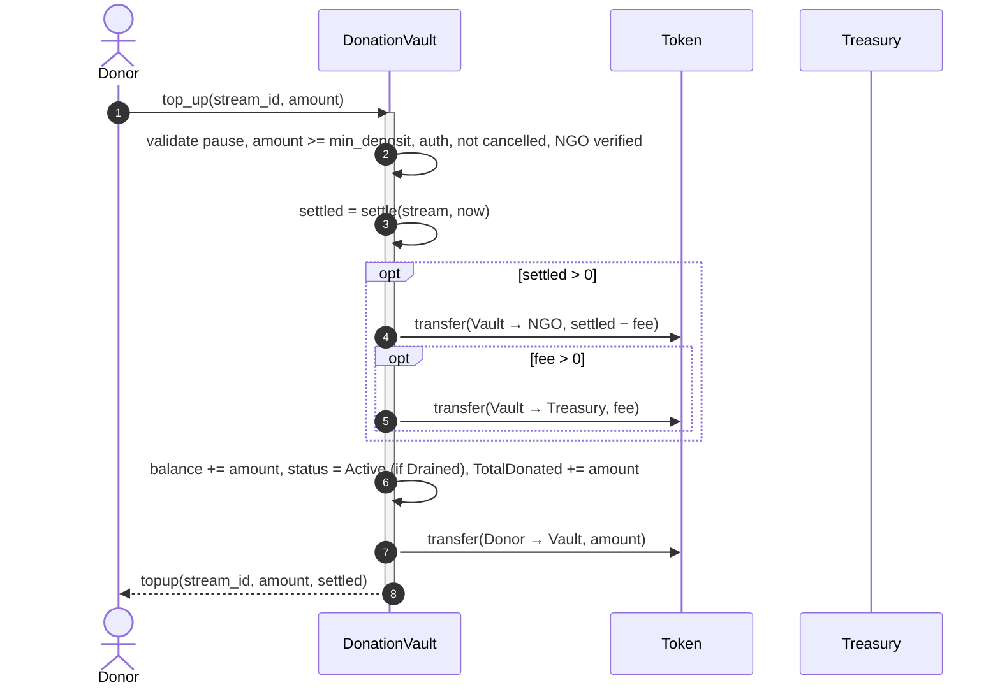
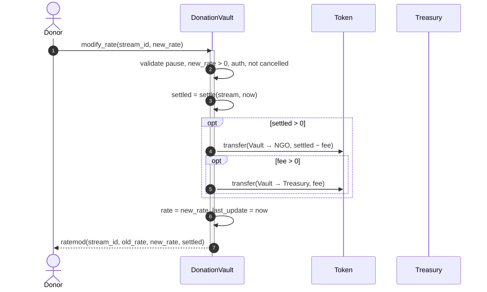
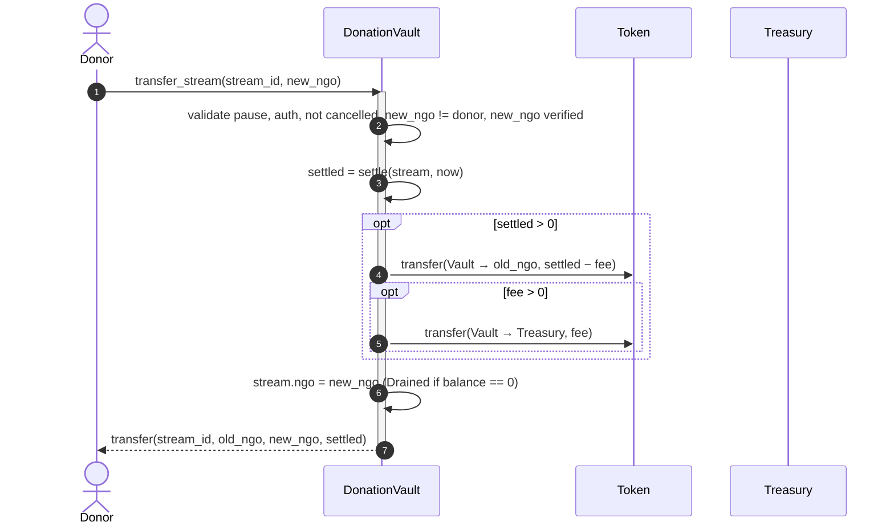
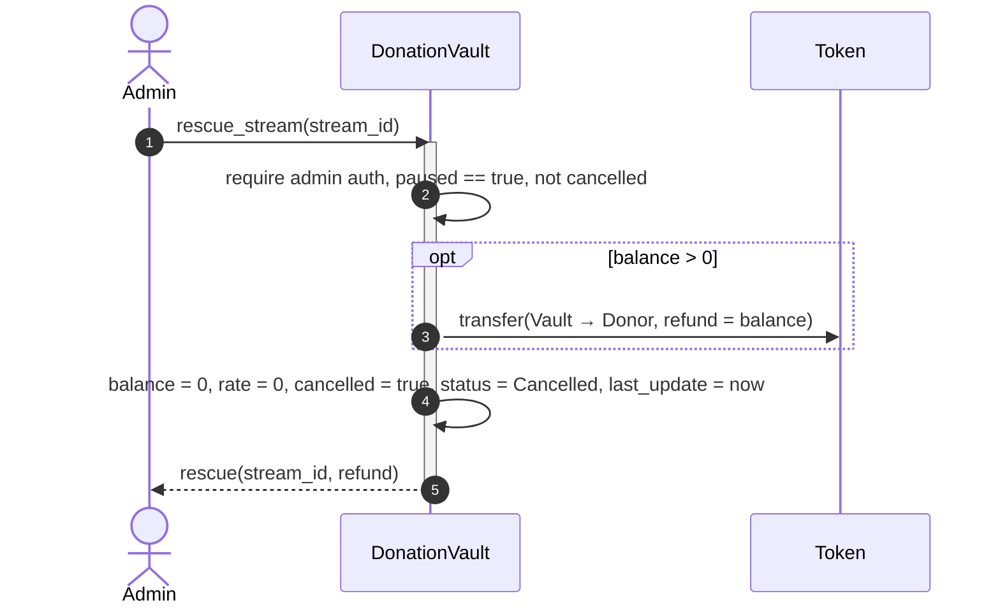
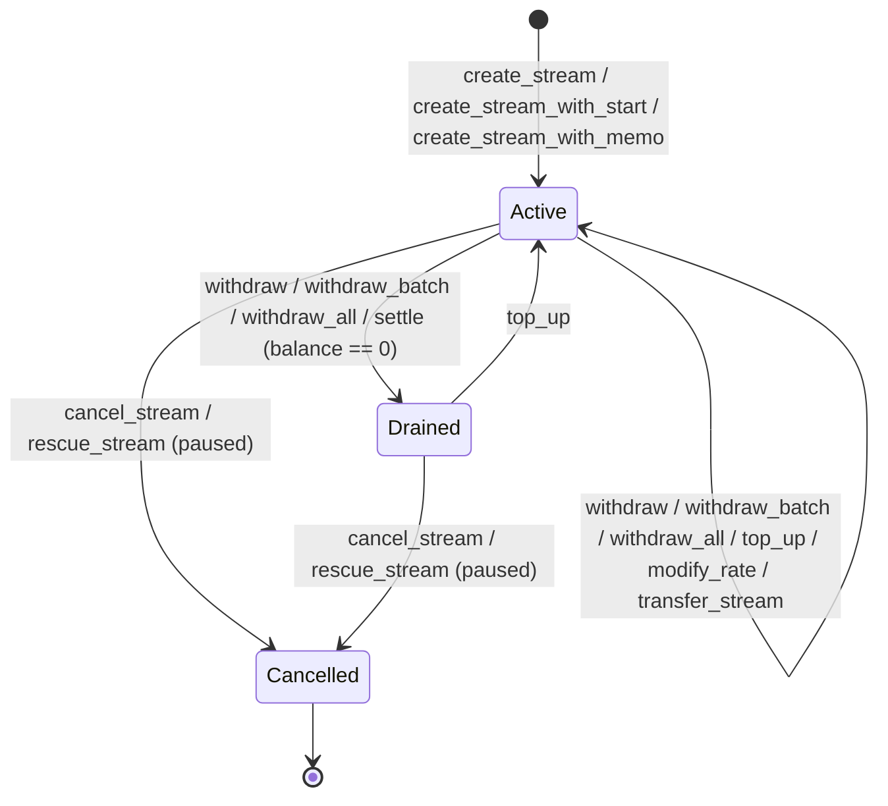

# Stream lifecycle

This document walks through the life of a `donation-vault` stream: how it is
created, how it accrues, how the NGO withdraws (individually or in a batch),
how the donor modifies, tops up, transfers, or cancels it, and how the admin
emergency `rescue_stream` path works while paused. It complements
[`EVENTS.md`](./EVENTS.md), which lists the events each step emits, and
[`STORAGE.md`](./STORAGE.md), which explains the storage and TTL layout.

## Actors

| Actor | Role |
| --- | --- |
| `Donor` | Funds the stream and can top it up, change its rate, transfer it to another NGO, or cancel it. |
| `NGO` | Receives the accrued funds and authorizes `withdraw`, `withdraw_batch`, and `withdraw_all`. |
| `DonationVault` | Holds the deposit and streams it to the NGO over time. |
| `Token` | The Stellar asset contract (SAC) the stream is denominated in. |
| `Treasury` | Optional recipient of the protocol fee, only used if configured. |
| `Admin` | Can pause/unpause the vault, configure fees/treasury/registry/limits, and call `rescue_stream` while paused. |

Key concepts:

- A stream stores `balance` (undrawn deposit), `rate` (units per second),
  `created_at` (fixed), `start` (the cliff — accrual never runs before it),
  `last_update` (moves on every checkpoint), `memo` (the donor's optional
  tag, at most `MAX_MEMO_BYTES` (32) bytes, empty when none was supplied —
  issue #341), `status` (`Active`, `Drained`, or `Cancelled`), and
  `cancelled` (`bool`).
- Nothing moves between checkpoints: accrual is computed lazily as
  `min(rate × elapsed, balance)` (see `math::accrued`), where `elapsed` is
  measured from `max(last_update, start)`.
- `create_stream` sets `start = created_at`, so a plain stream accrues
  immediately. `create_stream_with_start` takes an explicit `start` (up to one
  year ahead, `MAX_START_DELAY_SECONDS`), so a scheduled or trial-period pledge
  stays idle — `pending_accrual` is 0 and `withdraw` reverts with
  `Error::NothingToWithdraw` — until that ledger time arrives. `depletion_time`
  is likewise measured from `start`, and cancelling before `start` refunds the
  whole deposit because nothing has accrued.
- `create_stream_with_memo` creates an immediately-accruing stream tagged with
  an optional donor `memo` (issue #341). The memo is stored on the record and
  reported on the `created` event; anything over `MAX_MEMO_BYTES` (32) bytes is
  rejected with `Error::MemoTooLong` rather than truncated. A plain
  `create_stream` stores an empty memo.
- `set_memo` lets the donor replace that tag later (issue #441), under the
  same `MAX_MEMO_BYTES` limit, and publishes a `memoset` event carrying the old
  and new values. It is rejected with `Error::StreamCancelled` once the stream
  is cancelled; the memo has no effect on accrual either way.
- Every payout is checkpointed, so `last_update` always marks the last time
  the stream was settled.

## Choosing a rate

`rate` is an amount of the token's **smallest unit per second**, and `deposit`
uses the same unit. Neither is in whole tokens. Stellar assets have 7 decimal
places, so one whole token is `10,000,000` smallest units (for XLM, one lumen
is `10,000,000` stroops). If you forget that scale, or apply it twice, you are
off by a factor of ten million.

The contract has no idea of months. It only multiplies `rate` by elapsed
seconds (`min(rate × elapsed, balance)`), so the conversion from "X tokens a
month" happens in your client, and the client decides what a month is and how
to round.

### The conversion

```text
units_per_month = monthly_amount × 10^7          (7-decimal token)
rate            = floor(units_per_month / seconds_per_month)
```

`rate` must be a whole number of at least 1, so the division has to round. The
examples below use a 30-day month, `seconds_per_month = 30 × 86,400 =
2,592,000`. Pick one convention and use it everywhere: an average calendar
month (`365.25 × 86,400 / 12 = 2,629,800` seconds) is also fine, but the
backend, frontend, and any script must agree on it.

Do the whole calculation in integers (`i128`, `BigInt`, `u128`). A
floating-point `rate` passed through a JSON number can lose precision or end
up as a fraction the contract cannot accept.

### Worked examples (7-decimal token, 30-day month)

| Monthly amount | `units_per_month` | Exact units/second | `rate` (rounded down) | Paid per 30 days | Shortfall |
| --- | --- | --- | --- | --- | --- |
| 10 tokens | `100,000,000` | 38.580… | `38` | `98,496,000` (9.8496 tokens) | 1.504% |
| 100 tokens | `1,000,000,000` | 385.802… | `385` | `997,920,000` (99.792 tokens) | 0.208% |
| 1,000 tokens | `10,000,000,000` | 3,858.024… | `3858` | `9,999,936,000` (999.9936 tokens) | 0.00064% |

Step by step, for 10 tokens a month:

1. `10 × 10,000,000 = 100,000,000` units per month.
2. `100,000,000 / 2,592,000 = 38.580…` units per second.
3. Round down: `rate = 38`.
4. Check: `38 × 2,592,000 = 98,496,000` units, or 9.8496 tokens, every 30
   days. That is 1,504,000 units (0.1504 tokens) less than asked for.

The smaller the monthly amount, the bigger the rounding error, because the
dropped fraction of a unit per second is a larger share of a small rate. Show
donors the actual monthly amount, `rate × seconds_per_month`, not the amount
they typed.

### Rounding down vs. rounding up

Rounding the rate down never streams more than the donor agreed to. The
deposit just lasts a bit longer. `depletion_time` rounds up to whole seconds
(`ceil(balance / rate)`), so a deposit of exactly one month's amount runs for:

| Monthly amount | `rate` | Seconds to drain `units_per_month` | Longer than 30 days by |
| --- | --- | --- | --- |
| 10 tokens | `38` | `ceil(100,000,000 / 38) = 2,631,579` | 39,579 s (about 11 hours) |
| 100 tokens | `385` | `ceil(1,000,000,000 / 385) = 2,597,403` | 5,403 s (about 1.5 hours) |
| 1,000 tokens | `3858` | `ceil(10,000,000,000 / 3858) = 2,592,017` | 17 s |

Rounding up (`rate = 39` for 10 tokens) pays `39 × 2,592,000 = 101,088,000`
units per 30 days, 1.088% more than asked for, and a one-month deposit drains
in `ceil(100,000,000 / 39) = 2,564,103` seconds, almost 8 hours early. Use
round-down unless the donor has agreed to the higher amount.

In the last second of a stream, accrual is capped at the remaining `balance`,
so the NGO receives exactly the deposit and never a unit more.

### Sizing the deposit

There are two consistent ways to fund a pledge of N months:

- **Exact months:** `deposit = rate × seconds_per_month × N`. For 12 months at
  `rate = 38` that is `38 × 2,592,000 × 12 = 1,181,952,000` units (118.1952
  tokens), and the stream drains after exactly `31,104,000` seconds (360 days).
- **Exact amount:** `deposit = monthly_amount × 10^7 × N`. For 12 months that
  is `1,200,000,000` units (120 tokens), and the stream runs for
  `ceil(1,200,000,000 / 38) = 31,578,948` seconds, about 5.5 days longer than
  360 days.

### The smallest monthly amount

At `rate = 1` a stream pays `2,592,000` units (0.2592 tokens) per 30 days. A
smaller monthly amount rounds to `rate = 0`, which the vault rejects with
`Error::InvalidAmount`. A stream cannot carry less than one unit per second,
so the client should check the minimum and reject a smaller monthly amount
before it builds the transaction.

### Common mistakes

| Mistake | What gets sent | Result |
| --- | --- | --- |
| Passing whole tokens as the deposit | `deposit = 10` for "10 tokens" | Streams 0.000001 tokens. Usually rejected by `min_deposit` with `Error::DepositTooLow` if one is set, otherwise accepted silently. |
| Dividing whole tokens by seconds | `rate = floor(10 / 2,592,000) = 0` | Rejected with `Error::InvalidAmount`. |
| Using the monthly amount as the rate | `rate = 100,000,000` | 10 tokens **per second**, 25,920,000 tokens a month. A normal deposit drains in seconds. Rejected with `Error::RateTooHigh` if `max_rate` is set below it, or with `Error::StreamTooShort` if `min_duration` is set, otherwise accepted. |

`min_deposit`, `min_duration`, and `max_rate` are admin-configured guards
against these mistakes, not a replacement for getting the unit right. When
they are unset, the vault accepts any positive values.

The rate is gross: if a protocol fee is configured, it is taken out of each
payout, so the NGO receives slightly less than `rate × elapsed`. See
[`FEES.md`](./FEES.md).

## Happy path: create → accrue → withdraw → cancel

```mermaid
sequenceDiagram
    autonumber
    actor Donor
    actor NGO
    participant Vault as DonationVault
    participant Token as Token
    participant Treasury as Treasury

    Note over Donor,Treasury: create

    Donor->>Vault: create_stream(donor, ngo, token, deposit, rate)  %% or create_stream_with_start / create_stream_with_memo
    activate Vault
    Vault->>Vault: validate pause, auth, donor != ngo, amounts, cap, registry, memo
    Vault->>Vault: store Stream { balance = deposit, rate, status = Active, start, last_update = now, memo }
    Vault->>Token: transfer(Donor → Vault, deposit)
    Vault-->>Donor: created(stream_id, donor, ngo, token, deposit, rate, memo)
    deactivate Vault

    Note over Donor,Treasury: accrue (passive, between checkpoints)

    Note over Vault: accrued = min(rate × (now − max(last_update, start)), balance)

    Note over Donor,Treasury: withdraw

    NGO->>Vault: withdraw(stream_id)
    activate Vault
    Vault->>Vault: accrued = min(rate × elapsed, balance)
    Vault->>Vault: balance −= accrued, withdrawn += accrued, last_update = now (Drained if balance == 0)
    Vault->>Token: transfer(Vault → NGO, net = accrued − fee)
    opt fee > 0
        Vault->>Token: transfer(Vault → Treasury, fee)
    end
    Vault-->>NGO: withdraw(stream_id, accrued, fee, net)
    deactivate Vault

    Note over Donor,Treasury: cancel

    Donor->>Vault: cancel_stream(stream_id)
    activate Vault
    Vault->>Vault: settle accrued to NGO (if accrued > 0)
    opt accrued > 0
        Vault->>Token: transfer(Vault → NGO, accrued − fee)
        opt fee > 0
            Vault->>Token: transfer(Vault → Treasury, fee)
        end
    end
    Vault->>Vault: refund = balance; balance = 0, rate = 0, cancelled = true, status = Cancelled
    opt refund > 0
        Vault->>Token: transfer(Vault → Donor, refund)
    end
    opt accrued > 0 or refund > 0
        Vault-->>Donor: cancel(stream_id, accrued, refund)
    end
    deactivate Vault
```

Notes:

- `withdraw`, `withdraw_batch`, and `withdraw_all` require the **NGO's** auth;
  `create_stream`,
  `create_stream_with_start`, `create_stream_with_memo`, `top_up`,
  `modify_rate`, `transfer_stream`, and
  `cancel_stream` require the **donor's** auth; `rescue_stream` requires the
  **admin's** auth.
- `create_stream_with_start` is the cliff variant of `create_stream`: it
  behaves identically once `start` has passed, but until then nothing accrues
  and `depletion_time` counts from `start` rather than creation.
- `create_stream_with_memo` is the tagged variant of `create_stream`: it
  behaves identically, but stores the donor's `memo` (up to `MAX_MEMO_BYTES`
  bytes) on the record and in the `created` event.
- A stream with nothing accrued reverts `withdraw` with
  `Error::NothingToWithdraw`; `cancel_stream` on such a stream just refunds
  the whole balance.
- The protocol fee (per-token override or global `fee_bps`) is only taken when
  a treasury is configured; with no treasury the NGO receives the full amount
  (see `pay_ngo`).
- The stream record is kept (not deleted) after `cancel_stream` and
  `rescue_stream`, with `balance = 0`, `rate = 0`, `cancelled = true`, and
  `status = Cancelled`. Calling `cancel_stream` or `rescue_stream` again
  returns `Error::StreamCancelled`.

## Fork: batch withdrawal (`withdraw_batch`)

An NGO can claim accruals from up to `MAX_BATCH_WITHDRAW_STREAMS` (20) unique
streams in a single transaction. All streams must belong to the same NGO;
streams with zero accrual are skipped, and payouts are aggregated per token.

```mermaid
sequenceDiagram
    autonumber
    actor NGO
    participant Vault as DonationVault
    participant Token as Token
    participant Treasury as Treasury

    NGO->>Vault: withdraw_batch(stream_ids)
    activate Vault
    Vault->>Vault: validate pause, len <= 20, no duplicates, single NGO + auth
    loop each stream_id in stream_ids
        Vault->>Vault: compute accrued, per-stream fee, net
        opt accrued > 0
            Vault->>Vault: update balance, withdrawn, last_update, Drained if 0; accumulate per token
        end
    end
    Vault->>Vault: require total_accrued > 0 (else NothingToWithdraw)
    loop each token with net_total > 0
        Vault->>Token: transfer(Vault → NGO, net_total)
    end
    loop each token with fee_total > 0 (if treasury set)
        Vault->>Token: transfer(Vault → Treasury, fee_total)
    end
    loop each contributing stream
        Vault-->>NGO: withdraw(stream_id, accrued, fee, net)
    end
    deactivate Vault
```

## Fork: sweep an NGO's streams (`withdraw_all`)

`withdraw_all` collects from an NGO's streams a bounded page at a time without
the caller having to know any stream ids: it reads the NGO's stream index in
creation order and settles the slice `[start, start + limit)`, exactly like
`withdraw_batch` does. `limit` is clamped to `MAX_BATCH_WITHDRAW_STREAMS` (20).
The call returns `WithdrawAllPage { amounts, next }`, where `amounts` holds the
net payout per stream in page order and `next` is the cursor to pass as `start`
on the next call. Paging is done when `next` reaches the NGO's stream count.

Unlike `withdraw_batch`, a page that has accrued nothing is **not** an error: it
returns one `0` per stream and advances the cursor, so a dormant page in the
middle of a sweep never blocks the rest. A page where at least one stream
accrued emits the usual per-stream `withdraw` events and makes one net transfer
per token (plus any treasury fee transfer), identical to `withdraw_batch`.

```mermaid
sequenceDiagram
    autonumber
    actor NGO
    participant Vault as DonationVault
    participant Token as Token

    NGO->>Vault: withdraw_all(ngo, start, limit)
    activate Vault
    Vault->>Vault: validate pause; read NgoStreams index; clamp limit to 20
    Vault->>Vault: page = index[start .. start + limit]
    Vault->>Vault: settle page as withdraw_batch(page)
    alt page accrued nothing
        Vault-->>NGO: WithdrawAllPage { amounts: [0, ...], next }
    else
        Vault->>Token: transfer net per token to NGO payout address
        Vault-->>NGO: withdraw(stream_id, accrued, fee, net) per contributing stream
        Vault-->>NGO: WithdrawAllPage { amounts, next }
    end
    deactivate Vault
```

## Fork: top-up

A donor can add more funds to a live or drained stream (subject to
`min_deposit` and `require_verified_ngo`). The stream is settled first, so the
new funds only ever affect accrual going forward, and a `Drained` stream is
reactivated to `Active`.



## Fork: modify-rate

A donor can change the per-second rate. If `new_rate == stream.rate`, the call
returns `Ok(())` as a no-op without emitting an event. Otherwise, the old rate
is settled first so the new rate is never applied retroactively.



## Fork: transfer (`transfer_stream`)

A donor can reassign a live stream to a different NGO (rejecting
`new_ngo == donor` with `SelfStream`, and verifying `new_ngo` when a registry
is configured). If `new_ngo == stream.ngo`, the call is a no-op. Otherwise,
prior accrual is settled to the old NGO before `stream.ngo` is updated.



## Fork: emergency rescue (`rescue_stream`)

While the vault is paused, the admin can refund a stream's full remaining
balance directly to the donor without settling any accrued payout to the NGO.
Calling `rescue_stream` while the vault is active fails with `Error::NotPaused`.



## Lifecycle states



`Active` is the normal state, `Drained` means `balance` reached zero without
cancellation (and can return to `Active` via `top_up`), and `Cancelled` is
terminal. `pause` / `unpause` (admin-only) block `create_stream`, `withdraw`,
`withdraw_batch`, `withdraw_all`, `top_up`, `modify_rate`, and `transfer_stream`
globally,
leave `cancel_stream` available so donors can always recover their remaining
funds, and unlock `rescue_stream` for admin incident response.

## See also

- [`EVENTS.md`](./EVENTS.md) — every event in this flow, with topics and data.
- [`STORAGE.md`](./STORAGE.md) — where stream state lives and how TTLs are bumped.
- [`GAS.md`](./GAS.md) — simulating entry points and estimating resource footprints.
- [`../contracts/donation-vault/src/lib.rs`](../contracts/donation-vault/src/lib.rs) — the entry points.
- [`../contracts/donation-vault/src/math.rs`](../contracts/donation-vault/src/math.rs) — the accrual math.
